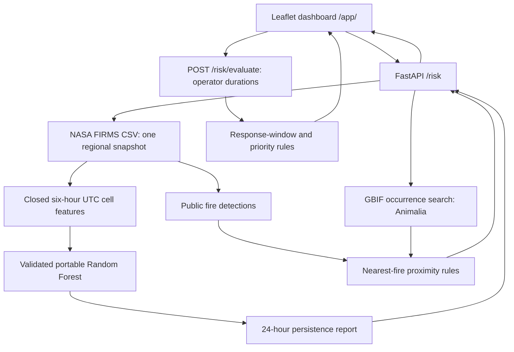

# Architecture

WildFyre is a stateless FastAPI application serving a static Leaflet dashboard
and JSON API from one loopback-bound process. There is no database, background
queue or separate model service.

## Data flow



## Application boundaries

| Component | Responsibility |
| --- | --- |
| [main.py](../backend/app/main.py) | Lifespan, CORS, route composition, sanitized errors and /app/ static serving. |
| [config.py](../backend/app/config.py) / [schemas.py](../backend/app/schemas.py) | Validated configuration and API contracts. |
| [Provider services](../backend/app/services/) | Requests/parsing for FIRMS and GBIF; no implicit sample fallback. |
| [Feature builder](../backend/app/models/features.py) | Pure grid, deduplication and current-window aggregation. |
| [Portable scorer](../backend/app/models/fire_model.py) | Integrity/schema validation, float32-compatible tree traversal and self-check. |
| [Persistence service](../backend/app/services/persistence.py) | Load-once model state and ready/empty/unavailable reports. |
| [Decision service](../backend/app/services/decisions.py) / [risk.py](../backend/app/risk.py) | Distance, response window and priority calculations. |
| [Frontend](../frontend/) | Safe DOM rendering, map, candidate selection and paused automatic refresh. |
| [Startup](../backend/app/startup.py) / [run.sh](../run.sh) | Pinned venv, verified model preparation and foreground server. |

Synchronous routes use bounded synchronous requests. FIRMS uses a one-day
California-area query; GBIF uses Animalia kingdom key 1 and at most three pages
of 100 records. Both use connect/read timeouts of 3.05/10 seconds. GBIF responses
retain observation dates, dataset attribution and licenses, and expose truncation.
Structurally failed providers return sanitized 503 responses; credentials and
raw upstream errors do not reach the browser.

## Three separate decision signals

### Proximity

For each animal occurrence, find its nearest fire using great-circle distance
with Earth radius 6371.0088 km. Include points within 25 km, inclusive:

```text
proximity = max(0, 1 - distance_km / 25)
```

Candidates sort by score, then ID. They represent observation points, not
confirmed habitats or current animal positions.

### Fire persistence

The accepted forest consumes 13 ordered FIRMS features. Its fixed grid origin
is west −124.5 / south 32.5, with approximate 5 km cells, 111.32 km per latitude
degree and longitude scaling at 37.3°. Deduplicate satellite/location/time,
retain normal/high confidence, and filter type 0 only when a type is supplied.

After provider retrieval, select the latest closed UTC six-hour interval.
At 13:05 UTC, inputs are [06:00,12:00), with a [12:00,next-day12:00) horizon.
Stale/open-window observations are excluded. Missing required headers or
classifications and malformed contributing rows yield unavailable results;
explicitly missing numeric measurements alone can use trained medians.
Unlocatable malformed rows conservatively make the batch unavailable.

Live inference supports VIIRS_SNPP_NRT and is labelled experimental. The
historical training data were SP vegetation detections; NRT may lack type.
No source equivalence, NRT calibration or complete satellite delivery is assumed.
Sample mode uses explicit synthetic inputs and a fixed window ending
2026-10-17T06:00:00Z.

### Operator timing

Baseline timings are null and priority is UNASSESSED. The operator supplies
hypothetical nonnegative durations:

```text
window = fire ETA - response time - safety buffer
window <= 0                   -> ALTERNATIVE RESPONSE
window > 0 and proximity >= .8 -> CRITICAL
window > 0 and proximity >= .5 -> HIGH
window > 0 and proximity <  .5 -> MODERATE
```

Negative/zero windows are preserved. Persistence scores do not replace the
proximity input, supply ETA or change these thresholds. Scenarios are not saved.

## HTTP contract

| Endpoint | Response |
| --- | --- |
| GET / | Process health; no provider query. |
| GET /fires | Normalized fires, mode and UTC retrieval timestamp. |
| GET /wildlife | Animal observations, mode, timestamp and truncation flag. |
| GET /risk | One shared provider snapshot, proximity candidates and fire_persistence. |
| GET /model/status | Readiness, model version, sanitized reason and startup self-check state. |
| POST /risk/evaluate | Stateless operator scenario assessment. |
| GET /app/ | Dashboard and same-origin assets. |

Persistence reports contain status ready/empty/unavailable, nullable reason and
model version, method random_forest, source product, mode, experimental/quality
flags, UTC input/horizon timestamps and cell results. Each cell exposes grid
coordinates/centre, contributing fire IDs/count and either a finite score in
[0,1] or an unavailable reason. No missing result becomes a zero prediction.

The browser waits up to 75 seconds for the multi-provider snapshot and 25 seconds
for scenario evaluation. It rejects stale responses, renders untrusted text as
text nodes and preserves provider attribution. Refresh is five minutes while
visible/idle and pauses when a timing candidate is selected.

## Model and deployment

[model.json](../models/fire-persistence/model.json) is the authoritative feature,
version, hash and evaluation contract. The reviewed compressed JSON forest is
bundled beside it because the repository's release URLs require authentication.
Startup verifies it, atomically prepares the ignored cache and loads/self-checks
it once. Serving uses the Python standard library plus existing backend packages;
scientific dependencies are confined to offline notebook/export verification.

The launcher binds 127.0.0.1:8000 and serves UI/API through one SSH-forwarded
port. No system pip, root account, Docker or service installation is needed for
the application workflow. Missing Python/venv support must be resolved on the host.
See the [runbook](linuxone-runbook.md), [model record](fire-persistence-model.md)
and [verification record](verification.md) for setup, evaluation and evidence.
